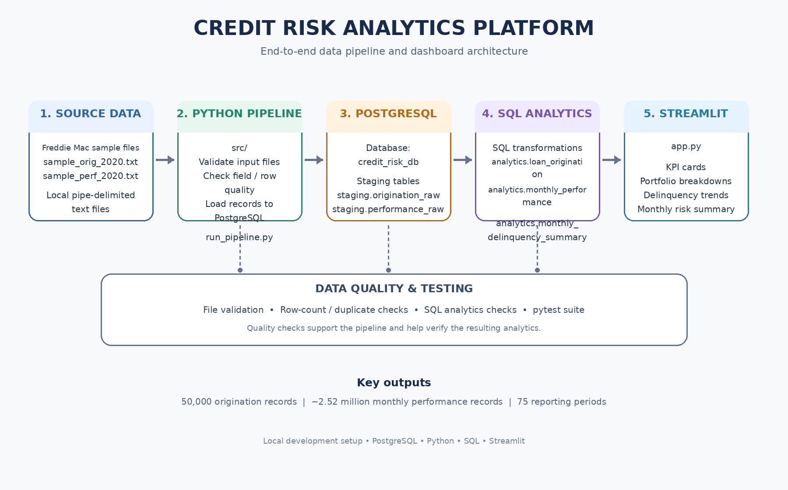
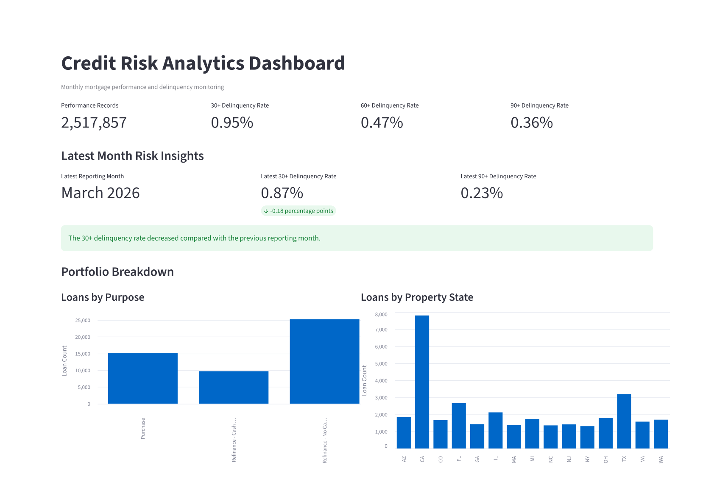
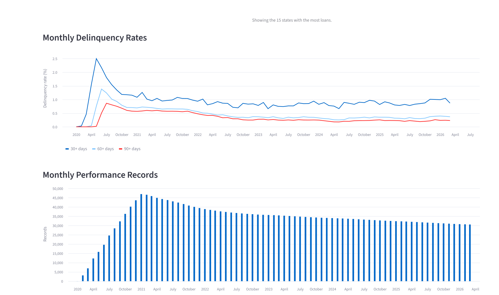
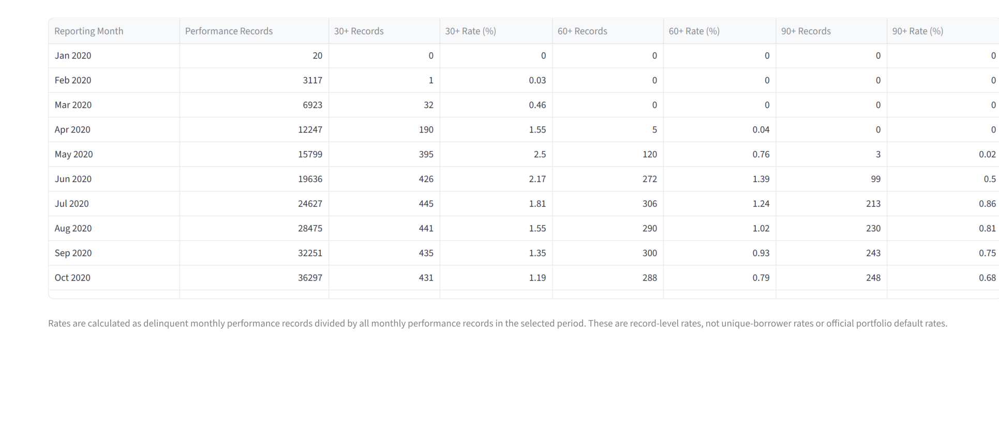

# Credit Risk Analytics & Data Engineering Platform

A local data engineering and analytics project that processes Freddie Mac Single-Family Loan-Level Dataset samples using Python and PostgreSQL, validates data quality, and presents portfolio risk indicators through an interactive Streamlit dashboard.

## Project Overview

Credit risk analytics helps financial institutions understand loan portfolio performance and monitor delinquency trends. This project demonstrates how loan origination and monthly loan performance data can be loaded, validated, transformed, and presented for analysis.

The project runs locally and uses PostgreSQL for data storage and SQL-based analytics. It does not require paid cloud services.

## Technology Stack

- **Python:** Data processing, pipeline orchestration, validation, and testing
- **PostgreSQL:** Staging data, analytics tables, joins, and aggregations
- **SQL:** Data transformation and monthly delinquency summaries
- **Streamlit:** Interactive dashboard
- **Pandas:** Tabular data handling and dashboard preparation
- **pytest:** Automated tests
- **psycopg:** Python-to-PostgreSQL connectivity

## Data Source

Freddie Mac Single-Family Loan-Level Dataset — 2020 sample files.

The local sample contains:
- 50,000 loan origination records
- 2,517,857 monthly performance records
- 75 monthly reporting periods in the analytics summary

The dataset contains loan-level information. Raw data files are intentionally excluded from public distribution by this repository's intended publishing policy.

## Architecture



```text
Freddie Mac Sample Files
          |
          v
Python Validation and Loading
          |
          v
PostgreSQL Staging Tables
          |
          v
SQL Analytics Transformations
          |
          v
Analytics Tables
          |
          v
Streamlit Dashboard
```

Automated tests and data-quality checks help validate the project components and dataset consistency.

## Dashboard Screenshots

### Dashboard Overview


### Delinquency Trends


### Monthly Risk Summary


## Main Components

### Python Pipeline — `src/`

- `load_to_postgres.py` — loads source data into PostgreSQL.
- `run_pipeline.py` — coordinates the pipeline steps.
- `run_data_quality_checks.py` — runs database-level quality checks.
- `validate_files.py` — validates source files.
- `validate_periods.py` — validates reporting periods.
- `check_duplicates.py` — checks for duplicate records.
- `profile_data.py` and `profile_delinquency.py` — support data profiling.
- `test_db_connection.py` — supports database connectivity testing.

### SQL — `sql/`

- `01_create_staging_tables.sql` — creates staging tables.
- `05_monthly_delinquency_queries.sql` — contains monthly delinquency analysis queries.
- `06_refresh_analytics.sql` — refreshes the analytics tables.

### Dashboard — `app.py`

The Streamlit dashboard includes:
- Performance record and delinquency KPI cards
- 30+, 60+, and 90+ delinquency rates
- Latest-month risk insights and month-over-month comparison
- Loan-purpose breakdown
- Property-state breakdown
- Monthly delinquency trend chart
- Monthly performance record chart
- Monthly risk summary table
- Reporting-month filters

The delinquency rates describe the records and calculations used by this project; they should not automatically be interpreted as unique-loan default probabilities.


### Documentation — `docs/`

Contains the project architecture diagram, Streamlit dashboard screenshots, and schema documentation for the Freddie Mac sample dataset.

### Automated Tests — `tests/`

The project currently has automated tests for project file presence, configured dataset expectations, and basic pass/fail comparison behavior.

## Data Quality

The database validation script checks:

1. Origination row count
2. Performance row count
3. Unique origination loans
4. Origination loans missing performance records
5. Performance loans missing origination records
6. Monthly summary period count
7. Monthly summary record total

The expected dataset counts are configured in `src/run_data_quality_checks.py`. If the dataset changes, review these expectations before rerunning the checks.

## Local Setup

### Prerequisites

- Python 3.11
- PostgreSQL
- The authorized Freddie Mac sample files
- Git, if you intend to clone or version-control the project

### 1. Create and activate a virtual environment

From the project root in PowerShell:

```powershell
python -m venv .venv
.\.venv\Scripts\Activate.ps1
```

If PowerShell blocks activation, use the Python executable directly or follow your local Python environment's activation policy.

### 2. Install dependencies

Activate the virtual environment created in Step 1, then install the project dependencies:

```powershell
.\.venv\Scripts\Activate.ps1
python -m pip install -r requirements.txt
python -m pip check
```

The final command checks for dependency conflicts. Ideally, it should report `No broken requirements found.`

If you open a new terminal later, activate `.venv` again before running the project.


### 3. Configure PostgreSQL

Create a local database named `credit_risk_db`, configure a PostgreSQL user, and run the staging-table SQL script.

Review the source scripts for the expected connection settings before running the loader. Supply the database password through the `PGPASSWORD` environment variable or the prompt provided by the scripts. Never commit database credentials.

### 4. Load and validate the data

After configuring the database and placing the authorized source files in the expected local data directory, review the pipeline configuration and run:

```powershell
python src/run_pipeline.py
```

This executes the pipeline and may write or refresh database tables. Confirm your database settings before running it.

Run the data-quality checks separately with:

```powershell
python src/run_data_quality_checks.py
```

### 5. Launch the dashboard

From the project root:

```powershell
streamlit run app.py
```

Open the local URL printed by Streamlit in your browser.

### 6. Run automated tests

Install `pytest` if needed, then run:

```powershell
python -m pytest tests -v
```

The initial automated test suite has passed 14 tests in the development environment. These tests cover project structure, configured expectations, and basic comparison behavior; they do not replace database integration tests.

## Repository Safety

Before publishing:

- Do not commit raw loan-level data or private borrower information.
- Do not commit passwords, tokens, `.env` files, or local database credentials.
- Exclude virtual environments, Python caches, and test caches.
- Review the repository contents and Git tracking status before pushing.

## Limitations and Future Improvements

- Add stronger unit tests that exercise the actual validation functions.
- Add database integration tests with controlled test data.
- Make pipeline configuration environment-driven.
- Add structured logging and clearer failure reporting.
- Document the exact source-file format and loading assumptions.
- Consider cloud architecture mappings as a future design exercise without deploying paid services.

## Disclaimer

This project is for educational and portfolio demonstration purposes. Its summary metrics are not a lending decision system, a validated credit-scoring model, or financial advice.
